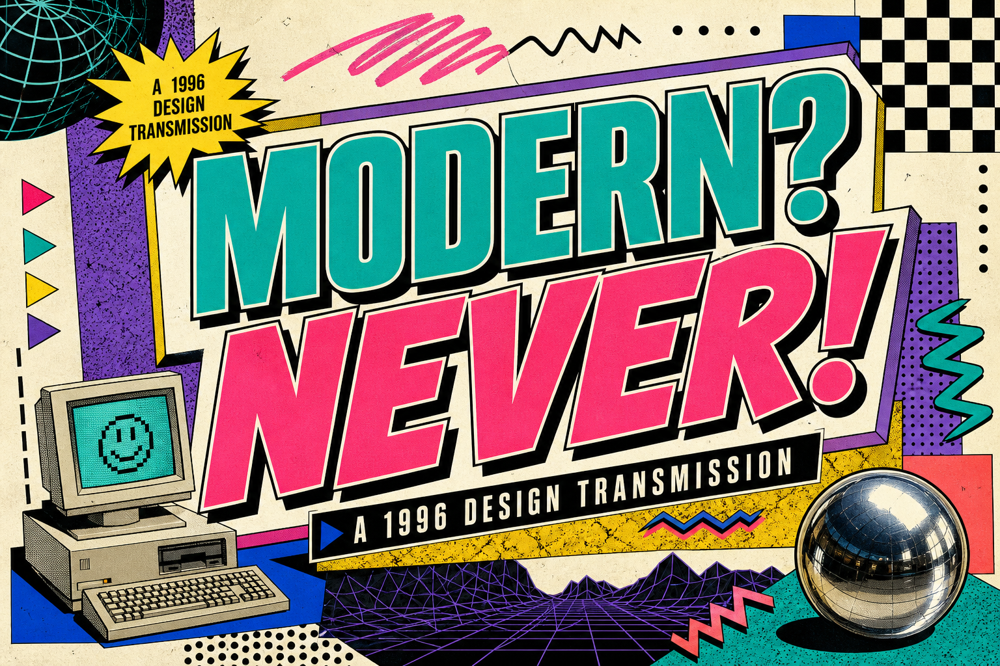

# MODERN? NEVER! | 90s Graphic Design



**A loud, interactive web-design experiment inspired by the early World Wide Web, 1990s print graphics, and experimental typography.**

This public React and TypeScript project explores a deliberately maximalist visual style: oversized editorial headlines, saturated color, irreverent navigation, bold panels, and nostalgic internet details.

## Explore the design

- **Immersive opening:** poster-scale typography and retro computer details.
- **Design manifesto:** an unapologetic argument for visible hierarchy and expressive interfaces.
- **Navigation and portals:** interactive sections that recreate the energy of early personal sites.
- **Responsive web layout:** implemented with modern React and CSS.

The entry point is `page.tsx`; styling is in `globals.css`, with layout in `layout.tsx`.

## Run locally

Requires **Node.js 22.13+** and npm.

```sh
git clone https://github.com/remriel/90s-graphic-design-site.git
cd 90s-graphic-design-site
npm install
npm run dev
```

Build and check the site:

```sh
npm run build
npm test
```

The app uses vinext and Vite. Project configuration is in `vite.config.ts` and `next.config.ts`. The repository includes optional Cloudflare D1 and Drizzle wiring; the visual website itself is the focus.

## Visual direction

1990s graphic design, internet nostalgia, maximalist web design, neon typography, bold composition, printed ephemera, and experimental browser interfaces. These are creative references; the implementation uses modern web tools.

## More visually expressive projects

- [Acid Xerox](https://github.com/remriel/acid-xerox-theme): a fluorescent, photocopied-zine-inspired Obsidian theme.
- [DictaTask](https://github.com/remriel/dictatask-android-native): an Android task board with bold 90s neo-brutalist interface design.

## Technology

React · TypeScript · CSS · vinext · Vite

This project showcases a design direction and its implementation, with no separate installer required.

<a href="https://buymeacoffee.com/remriel"></a>
